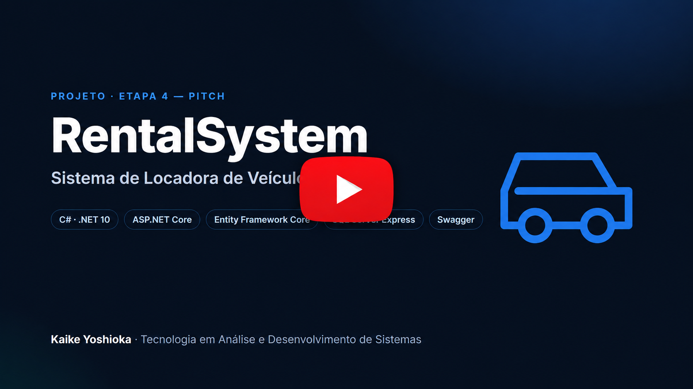

# RentalSystem

Tema: Desenvolver um sistema de aluguel de veículos utilizando C# 6.0 (ou superior), Entity Framework, SQL Express como banco de dados e Swagger para testes.
# Video de Apresentação
[](https://www.youtube.com/watch?v=ePM-24E5D4g)

Requisitos:

O trabalho será dividido em 4 etapas:

1.Modelagem do Banco de Dados;
2.Criação de registros e execução de consultas;
3.Implementação do Backend; e
4.Apresentação do trabalho (pitch).

Etapa 1: Modelagem do Banco de Dados ✅

1.1. Crie um modelo conceitual para o banco de dados da locadora de veículos, considerando entidades como Veículo, Fabricante (marca), Cliente, Aluguel, etc, com colunas (atributos) que julgar necessário, obedecendo às seguintes regras:

Todo veículo pertence a um fabricante e deve ter registrado seu modelo, ano de fabricação e quilometragem;
O cliente deve ter pelo menos nome, CPF e e-mail;
Todo aluguel está atrelado a um cliente, um veículo em um dado período de tempo;
É necessário registrar a devolução do veículo em um aluguel, além da quilometragem inicial e final do aluguel, o valor da diária e valor total da locação;
1.2. Utilize o Entity Framework para traduzir o modelo conceitual em um esquema de banco de dados relacional.

1.3. Defina as chaves primárias, estrangeiras e outras restrições necessárias para manter a integridade dos dados.

1.4. Implemente as classes de entidades em C# que representam as tabelas do banco de dados.

1.5. O banco deve possuir no mínimo 5 entidades, ou seja, uma além das citadas no item 1.1.

 

Etapa 2: Implementação do Backend ✅

2.1. Desenvolva um backend em C# 6.0 (ou superior) utilizando o ASP.NET Core para criar APIs RESTful que irão interagir com o banco de dados.

2.2. Implemente endpoints para operações CRUD (Criar, Ler, Atualizar, Deletar) para as entidades do sistema (veículos, clientes, etc.).

2.3. Utilize o Entity Framework para conectar e interagir com o banco de dados SQL Express.

2.4. Garanta a validação dos dados de entrada e saída nas APIs, incluindo tratamento de erros e exceções.

2.5. O backend deve possuir rotas para 5 filtros diferentes que utilizem pelo menos dois tipos de joins de tabelas diferentes

 

Etapa 3: Testes e Documentação ✅

3.1. Integre o Swagger ao projeto para documentar e testar as APIs desenvolvidas.

3.2. Documente cada endpoint, especificando os métodos HTTP permitidos, os parâmetros necessários e os possíveis códigos de resposta em um documento de formato livre. 

3.3. Utilize o Swagger para realizar testes manuais das APIs, verificando se todas as operações estão funcionando conforme o esperado. Os testes devem ser evidenciados em um relatório de testes contendo a chamda de cada método das APIs e também o retorno obtido. Utilize prints de tela para tal.

 

Etapa 4: Vídeo Apresentação em formato Pitch ⏳

Produção de um vídeo demonstrativo que apresente o funcionamento do sistema de locadora de veículos desenvolvido.
O vídeo deve abordar as principais funcionalidades do sistema, como cadastro de veículos, clientes, realização de reservas, entre outros.
Demonstre como utilizar as APIs desenvolvidas para interagir com o sistema.
Certifique-se de que o vídeo seja claro, bem estruturado e de fácil compreensão para o público-alvo.
Após a produção do vídeo demonstrativo, este deverá ser disponibilizado em uma plataforma de compartilhamento de vídeos, como o YouTube.
O link para o vídeo deverá ser inserido no relatório acadêmico, permitindo fácil acesso aos avaliadores e demais interessados.
Certifique-se de que o vídeo esteja devidamente hospedado e acessível durante o período de avaliação do relatório.
O tempo do vídeo deve variar entre 6 e 12 minutos, considerando a demonstação e uma breve explicação do sistema.

---

# Trabalho Prático 2 — Front-end integrado

Front-end em **HTML, CSS, Bootstrap e JavaScript** (pasta `RentalSystem.Front/`), integrado à API do Trabalho
Prático 1 **somente com `fetch`**. Nenhum dado é fixo no código: tudo vem do banco pela API.

## Avaliação

| Requisito | Onde |
|---|---|
| Usar os artefatos do Trabalho Prático 1 | mesma API (`RentalSystem/`), mesmas entidades e as 5 rotas de `/api/Filtros` |
| Wireframes (Figma, média fidelidade, tons de cinza) | [RentalSystem – Wireframes Front-end (TP2)](https://www.figma.com/design/vmaOX85afT3DBG3QZUE7ro) |
| Cadastro, edição, exclusão e pesquisa de todas as entidades | `fabricantes.html`, `veiculos.html`, `clientes.html`, `alugueis.html`, `pagamentos.html` |
| Filtros personalizados em pelo menos dois campos por entidade | formulário de filtros de cada tela, enviado como *query string* para a API (tabela abaixo) |
| Usar as rotas de consulta (JOINs) | `consultas.html` (as 5 rotas) e `index.html` (`alugueis-pendentes`) |
| Pasta específica para o front-end | `RentalSystem.Front/` |
| Relatório (modelo SBC) | `docs/relatorio/relatorio.pdf` (fonte LaTeX em `docs/relatorio/relatorio.tex`) |

## Como executar

1. Rode a API como no Trabalho Prático 1 (Visual Studio, perfil **http**, ou `dotnet run --project RentalSystem`).
   Ela sobe em **http://localhost:5127** (Swagger em `/swagger`).
2. Abra `RentalSystem.Front/index.html` no navegador. Também funciona com a extensão *Live Server* do VS Code.

Se a API estiver em outra porta, ajuste `urlBase` em `RentalSystem.Front/js/comum.js`.
O Bootstrap e os ícones são carregados pela CDN do jsDelivr, então o navegador precisa de internet.

## Telas

| Tela | Arquivo | O que faz |
|---|---|---|
| Início | `index.html` + `js/inicio.js` | Indicadores (frota, clientes, aluguéis em aberto, total recebido) e aluguéis pendentes com atalho para registrar a devolução |
| Fabricantes | `fabricantes.html` + `js/fabricantes.js` | CRUD, filtros por nome e por "possui veículos", quantidade de veículos de cada um |
| Veículos | `veiculos.html` + `js/veiculos.js` | CRUD, filtros por modelo, fabricante, ano e km, situação (alugado/disponível) |
| Clientes | `clientes.html` + `js/clientes.js` | CRUD com máscara e validação de CPF, filtros por nome, CPF e e-mail |
| Aluguéis | `alugueis.html` + `js/alugueis.js` | CRUD, filtros por cliente, veículo, status e período, cálculo das diárias, **registro de devolução** (atualiza também a km do veículo) |
| Pagamentos | `pagamentos.html` + `js/pagamentos.js` | CRUD, filtros por aluguel, método, valor e período, saldo do aluguel |
| Consultas | `consultas.html` + `js/consultas.js` | As 5 rotas de `/api/Filtros`, com o SQL equivalente, busca no resultado e totais |

Regras validadas no front antes de chamar a API: campos obrigatórios, CPF válido, ano de fabricação, devolução prevista
não anterior ao início, km final não menor que a inicial, veículo com aluguel em aberto não pode ser alugado de novo,
pagamento não pode passar do saldo do aluguel. Os erros devolvidos pela API (400, 404, 409, 500) aparecem na tela.

## Alterações na API para o TP2

- **CORS** liberado em `Program.cs` para o front-end conseguir chamar a API.
- **Filtros nos GETs** (todos opcionais, combináveis):

| Rota | Parâmetros |
|---|---|
| `GET /api/Fabricantes` | `nome`, `comVeiculos` (true/false) |
| `GET /api/Veiculos` | `modelo`, `fabricanteId`, `anoMin`, `anoMax`, `kmMax` |
| `GET /api/Clientes` | `nome`, `cpf`, `email` |
| `GET /api/Alugueis` | `clienteId`, `veiculoId`, `status` (aberto/devolvido), `dataInicioDe`, `dataInicioAte` |
| `GET /api/Pagamentos` | `aluguelId`, `metodo`, `valorMin`, `dataDe`, `dataAte` |

- **Exclusão protegida (409 Conflict):** as chaves estrangeiras estão com exclusão em cascata. Por isso, excluir um
  fabricante apagaria os veículos dele, e excluir um veículo apagaria os aluguéis e pagamentos ligados a ele. Agora a API
  recusa a exclusão de fabricante com veículos, veículo ou cliente com aluguéis e aluguel com pagamentos.

## Estrutura do front-end

```
RentalSystem.Front/
  index.html, fabricantes.html, veiculos.html, clientes.html,
  alugueis.html, pagamentos.html, consultas.html
  css/style.css        tema (índigo e papel) sobre o Bootstrap 5
  js/comum.js          URL da API, fetch, formatação (R$, datas, km), toasts, validação, modal de exclusão
  js/<tela>.js         lógica de cada tela
```
